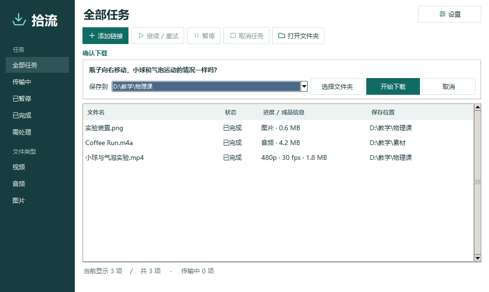

# 拾流 · Media Harbor

拾流是一款 Windows x64 网页媒体下载器。在桌面粘贴 B 站或 YouTube 链接即可选择画质、保存视频或只下载音频。装上浏览器扩展后，也可以直接在播放器上点「下载视频」，或一次保存网页里的多张图片。

**[下载 Windows x64 安装包](https://github.com/Jonathan1He/media-harbor/releases/latest/download/MediaHarbor-Setup-x64.exe)** · [版本记录与校验值](https://github.com/Jonathan1He/media-harbor/releases)

## 安装与使用

1. 运行 **MediaHarbor-Setup-x64.exe**。安装完成后拾流会打开，以后可以从 Windows 开始菜单启动。
2. 按 **Ctrl+N**，粘贴视频链接，点「解析链接」。选择画质后点「保存视频」，或点「仅音频」。
3. 在「确认下载」中选择文件夹，点「开始下载」。下次会预选最近使用的位置，下拉框保留最近 8 个目录。希望始终保存到同一处时，在「设置」选择默认目录，取消勾选「下载前确认保存位置」。

### 从 Chrome 或 Edge 下载

安装器最后会打开 **extension** 文件夹。在 Chrome 打开 `chrome://extensions`，或在 Edge 打开 `edge://extensions`。开启「开发者模式」，点击「加载已解压的扩展程序」，选择这个文件夹，然后刷新已打开的网页。

如果刚才关掉了文件夹，在资源管理器地址栏输入 `%LOCALAPPDATA%\MediaHarbor`，打开本次安装的 `app-…` 子目录，再选择里面含有 `manifest.json` 的 `extension` 文件夹。

| 想保存的内容 | 操作 |
| --- | --- |
| 正在播放的视频或音频 | 点击播放器上的下载按钮。拾流会唤起桌面窗口，默认先让你确认保存位置。 |
| B 站或 YouTube 的指定画质 | 点击浏览器工具栏的「拾流」→「读取画质」，选择具体档位，再点「下载视频」。 |
| 网页图片 | 打开扩展的「图片」页，勾选图片，再点「保存所选图片」。同一批只选一次目录。 |

在桌面任务列表可以暂停、继续、重试或打开保存文件夹。退出时正在传输的任务会在下次启动时恢复；遇到已过期的媒体地址，需要回原网页重新选取。

## 解析与下载

- **B 站**支持普通 BV/av 投稿与分 P。复制链接时保留 `?p=2` 即可选择第 2 P。匿名样片实测为 852 × 480，成品包含 H.264 视频和 AAC 音频。登录后的 1080p 尚未实测。
- **YouTube** 匿名下载 Blender 基金会《Big Buck Bunny》实测为 1920 × 1080、60 fps。自动画质会在可用档位中优先选择不超过 1080p 的最高档。
- **其他网页**支持媒体直链、HLS 和 DASH。如果扩展列表为空，先播放媒体，然后点扩展里的「刷新」。Edge 扩展与桌面程序的完整流程已验证。Chrome 正式版手动加载后的完整流程尚待验证。

**遇到 HTTP 412，或找不到网页上能播放的画质？** 在 B 站或 YouTube 官网打开视频并开始播放。如果该档位需要账号，先在官网登录。然后打开拾流扩展，展开「使用当前登录状态」，点「用当前播放器重试」。可保存的画质取决于这次播放实际提供的轨道。请仅保存你有权下载的内容。

## 浏览器权限与本地记录

扩展需要访问 HTTP 和 HTTPS 网页，才能识别各个标签页里的图片、音频和视频。发现的资源列表暂存在浏览器会话中。「用当前播放器重试」由你手动触发，网页沿用自己的登录状态，扩展将取得的媒体地址交给本机桌面程序。拾流无需你输入平台密码，也不导出浏览器 Cookie。

桌面端把任务名称、来源、文件路径和最近保存目录记在当前 Windows 账户的 `%LOCALAPPDATA%\MediaHarbor\data\queue.sqlite3`。如果需要反馈问题，提供版本、错误提示和可公开的复现步骤即可。分享截图或链接前，请隐去私人目录、账号标识和临时媒体参数。

## 源码与构建

| 路径 | 用途 |
| --- | --- |
| `desktop.py`、`desktop_ui.py` | Windows 窗口、任务队列与历史保存位置 |
| `core.py`、`engine.py`、`bridge.py` | 持久化、媒体解析与下载、浏览器原生通信 |
| `extension/` | Chrome 和 Edge 的 Manifest V3 扩展 |
| `packaging/` | Windows 启动器、安装器、构建脚本与第三方组件说明 |
| `tests/` | 下载、B 站分 P、桌面通信与浏览器验收 |

构建需要 Windows x64、包含 Tcl/Tk 的 CPython 3.12，以及 Windows .NET Framework 4.x 的 C# 编译器。准备一个依赖目录，将 `yt-dlp[default]` 和 Pillow 安装到其中的 `vendor/`，将 FFmpeg、ffprobe、aria2c、Node.js 的 Windows 可执行文件及依赖放到 `tools/`，将组件许可证放到 `licenses/`。组件版本和来源见[第三方组件清单](packaging/THIRD-PARTY.md)。

在项目根目录运行 `python packaging/build.py <依赖目录>`，得到 `output/MediaHarbor-Setup-x64.exe`。安装器支持 `--extract <新目录>`，可仅解包用于核验。通过 `HARBOR_DATA`、`HARBOR_TOOLS`、`HARBOR_VENDOR` 可将测试与日常下载记录隔离。

运行 `python tests/acceptance.py <临时目录>` 验证本地传输，`python tests/bilibili_posts.py` 验证 B 站格式和分 P 处理，`python tests/desktop_native.py <解包目录> <临时目录>` 验证桌面通信和目录记忆。浏览器测试见 `tests/browser.cjs`。

